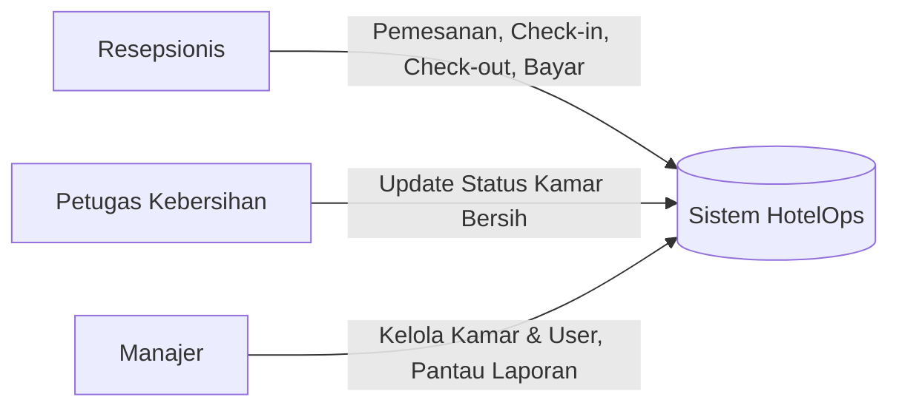
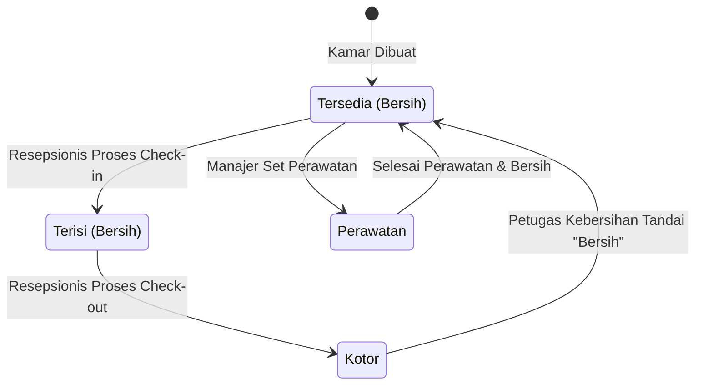
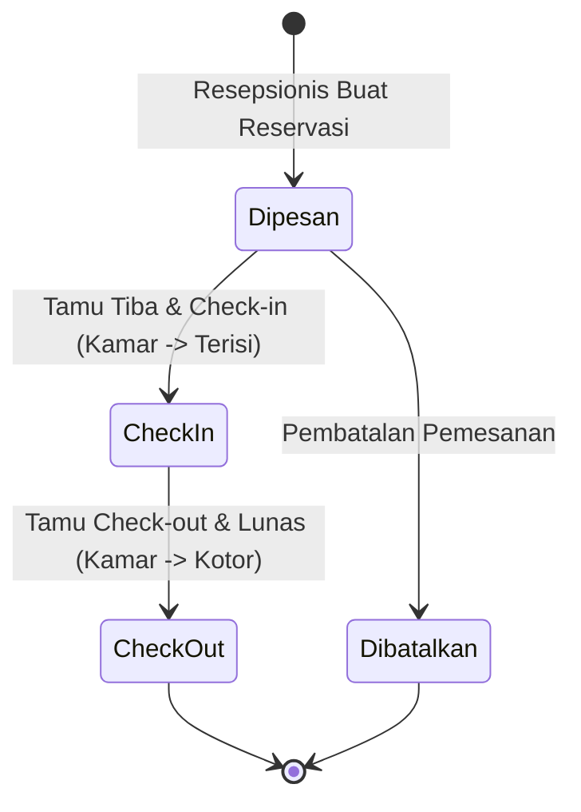
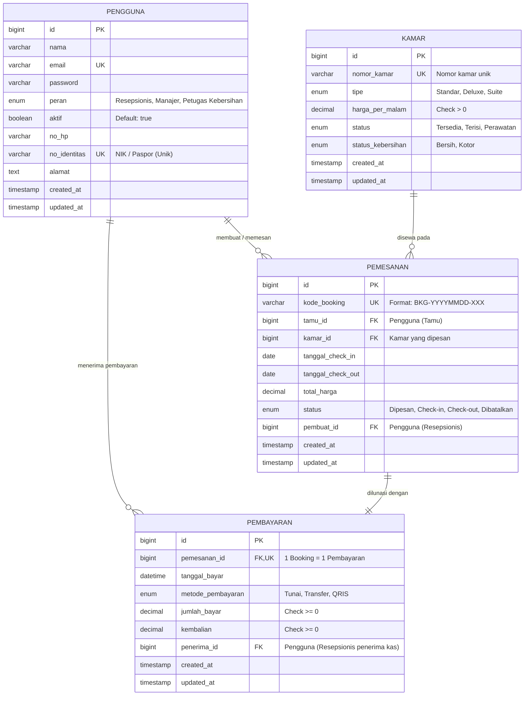

# Rencana Pengembangan Website Sistem Manajemen Operasional Hotel (HotelOps)
> Dokumen Perencanaan Rekayasa Perangkat Lunak (Tugas Semester 3)
> Sumber Spesifikasi: [New Text Document.txt](file:///d:/Tugas%20semester%203/RPL/tubes%20lagi/New%20Text%20Document.txt)

---

## 1. Ikhtisar & Ruang Lingkup Sistem

Sistem ini dirancang sebagai **Sistem Operasional Meja Depan (Front-Desk & Hotel Operations Management System)** internal hotel untuk mempermudah operasional harian hotel, menghilangkan pencatatan manual ketersediaan kamar, dan mempercepat pembuatan laporan manajerial.

---

## 2. Aktor & Matriks Hak Akses (RBAC Matrix)

| Modul / Fitur | Resepsionis | Petugas Kebersihan | Manajer |
| :--- | :---: | :---: | :---: |
| **Kelola Data Master Kamar (CRUD)** | ❌ (Hanya lihat) | ❌ (Hanya lihat) | ✅ (Full CRUD) |
| **Hapus Data Kamar** | ❌ Dilarang | ❌ Dilarang | ✅ Diizinkan |
| **Kelola Akun Pengguna / Staf** | ❌ Dilarang | ❌ Dilarang | ✅ Diizinkan |
| **Registrasi & Data Profil Tamu** | ✅ Diizinkan | ❌ Dilarang | ✅ Diizinkan |
| **Buat Pemesanan (Booking)** | ✅ Diizinkan | ❌ Dilarang | ✅ Diizinkan |
| **Proses Check-in & Check-out** | ✅ Diizinkan | ❌ Dilarang | ❌ Dilarang |
| **Pencatatan Pembayaran Meja Depan** | ✅ Diizinkan | ❌ Dilarang | ❌ Dilarang |
| **Hapus Riwayat Pembayaran Terverifikasi** | ❌ Dilarang | ❌ Dilarang | ❌ Dilarang (Aturan Bisnis) |
| **Update Status Kebersihan Kamar** | ❌ Dilarang | ✅ Diizinkan | ✅ (Bypass jika darurat) |
| **Laporan Okupansi Harian** | ❌ Dilarang | ❌ Dilarang | ✅ Diizinkan |
| **Laporan Pendapatan Bulanan** | ❌ Dilarang | ❌ Dilarang | ✅ Diizinkan |
| **Laporan Riwayat Tamu Bulanan** | ❌ Dilarang | ❌ Dilarang | ✅ Diizinkan |

---

## 3. Alur Kerja & State Transition (Otomasi Status)

### 3.1. Mesin Status Kamar (Room State Machine)
- **Kamar Dibuat:** Default Status = `Tersedia`, Kebersihan = `Bersih`.
- **Tamu Check-In:** Status Kamar otomatis berubah menjadi `Terisi`.
- **Tamu Check-Out:** Status Kebersihan otomatis berubah menjadi `Kotor`.
- **Pembersihan Selesai:** Petugas Kebersihan menekan "Set Bersih", status kebersihan menjadi `Bersih` dan status kamar kembali menjadi `Tersedia`.

### 3.2. Mesin Status Pemesanan (Booking Lifecycle)

---

## 4. Perancangan Basis Data (Database Design & ERD)

### Aturan Bisnis & Validasi Kunci:
1. `nomor_kamar` wajib unik.
2. `harga_per_malam` wajib $> 0$.
3. `no_identitas` pengguna wajib unik.
4. `jumlah_bayar` $\ge 0$ dan kembalian dihitung: $\text{kembalian} = \text{jumlah\_bayar} - \text{total\_harga}$.
5. Hapus Kamar hanya boleh dilakukan oleh Manajer.
6. Riwayat pembayaran yang sudah diverifikasi **tidak boleh dihapus** oleh siapapun.

---

## 5. Fitur Halaman & Antarmuka Berdasarkan Peran

1. **Panel Resepsionis:**
   - Tampilan visual kamar (Grid status: Hijau = Tersedia, Merah = Terisi, Kuning = Kotor).
   - Form pendaftaran tamu & pembuatan reservasi baru.
   - Menu aksi cepat Check-In & Check-Out.
   - Modal Kasir Meja Depan: Rincian tagihan, kalkulator kembalian instan, cetak nota/invoice kuitansi.
2. **Panel Petugas Kebersihan:**
   - Halaman daftar tugas kamar kotor (*mobile friendly*).
   - Tombol cepat 1-klik: "Tandai Bersih" untuk mengembalikan kamar ke status *Tersedia*.
3. **Panel Manajer:**
   - Master Data Kamar: Tambah/Edit/Hapus kamar dan set tarif per malam.
   - Manajemen Akun Pengguna: Kelola staf resepsionis dan kebersihan.
   - Menu Laporan & Ekspor:
     - **Laporan Okupansi Harian**: Nomor kamar, tipe, status, persentase keterisian harian.
     - **Laporan Pendapatan Bulanan**: Rincian booking, tamu, metode bayar (Tunai/Transfer/QRIS), total penerimaan, cetak PDF/Excel.
     - **Laporan Riwayat Tamu Bulanan**: Rekap data tamu, kamar yang pernah disewa, dan total durasi menginap.

---

## 6. Rekomendasi Tech Stack & Roadmap Pelaksanaan (4 Sprint)

- **Backend:** Laravel 11 (PHP 8.2+) dengan Blade Template + Tailwind CSS & Alpine.js.
- **Database:** MySQL / MariaDB.
- **Laporan:** `barryvdh/laravel-dompdf` untuk cetak PDF laporan & kuitansi.

| Sprint | Fokus Pengerjaan | Luaran (Deliverables) |
| :---: | :--- | :--- |
| **Sprint 1** | Setup & Fondasi DB | Skema Database, Migration, Seeder, dan Auth dengan Role-Based Middleware |
| **Sprint 2** | Master Data & Reservasi | Modul Kamar (CRUD Manajer), Modul Registrasi Tamu & Pemesanan Kamar (Resepsionis) |
| **Sprint 3** | Operasional & Kebersihan | Modul Check-in, Modul Kasir Check-out & Pembayaran, Panel Kebersihan (Housekeeping) |
| **Sprint 4** | Laporan Manajerial & Testing | Laporan Okupansi Harian, Pendapatan Bulanan, Riwayat Tamu, Cetak PDF, Pengujian Black Box |
